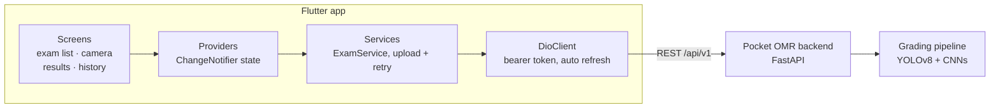
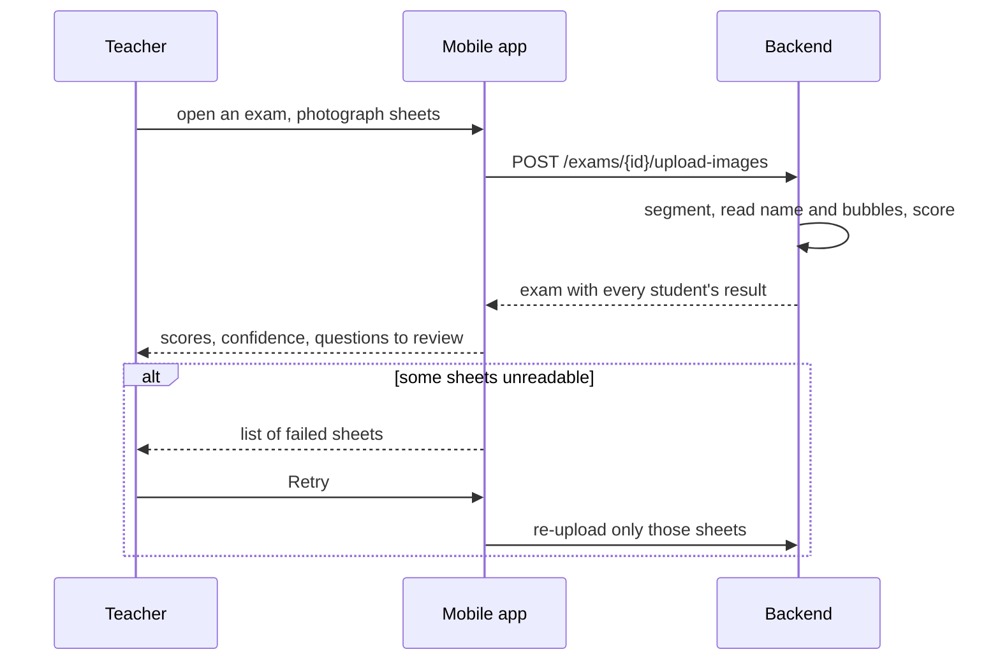

# Pocket OMR: Mobile App

**The teacher's tool in the classroom: pick an exam, photograph the students' answer sheets, and see every grade a few seconds later.**

A Flutter app for **Pocket OMR**, a system that grades multiple-choice exams from smartphone photos. The app captures the sheets; the [backend](https://github.com/Inesaini/pocket-omr-backend) reads the bubbles and each student's handwritten name.

## Highlights

- **Complete scan-to-grade workflow:** in-app camera or photo/`.zip` import, upload with progress, per-student results, and one-tap retry for sheets that couldn't be read.
- **Teacher stays in control:** questions the model was unsure about are flagged per student ("Review Q2, Q5").
- **Clean architecture:** feature-first folders and a strict Screen → Provider → Service → HTTP client layering.
- **Secure sessions:** JWT bearer tokens with automatic refresh and retry on `401`, and server-side revocation on logout.
- **Cross-platform:** one Dart codebase for Android, iOS, web and desktop.

**Stack:** Flutter · Dart · Provider · Dio · camera / image_picker · shared_preferences

## My contribution

I built this entire mobile app: authentication, the home, exam list, camera, results,
history and profile screens, the upload and retry flow, and the networking layer that
connects it to the backend.

Beyond this repository, I built the whole
[backend](https://github.com/Inesaini/pocket-omr-backend), including the student list
feature, improved the web frontend (API integration, student list, grid and correction
sheets, Excel export of grades), and contributed to the handwritten name recognition model
and the sheet segmentation pipeline.

## Features

- **Scan answer sheets** with the in-app camera, or pick existing photos or a `.zip` of a
  whole class from the device.
- **Automatic grading:** sheets are uploaded to the backend and come back with the
  recognised student, score and confidence.
- **Retry failed sheets:** if a photo can't be read, a dialog lists the failed sheets and
  re-uploads only those.
- **Review flags:** questions the model was unsure about are highlighted per student
  ("Review Q2, Q5") so the teacher can check them by hand.
- **Exam list and search:** exams still to correct, recent activity, and a searchable
  history with average score and confidence per exam.
- **Manage results:** open an exam's results, keep scanning, or delete a wrongly graded
  paper.
- **Accounts:** sign up, sign in, password reset by email code, profile view and edit,
  with automatic token refresh.

## Architecture



Screens never call the network directly: providers hold the state, services do the work, and `DioClient` handles authentication for every request.

### Scan and grade flow



## Run it

Requires the Flutter SDK (`^3.11.1`) and the [backend](https://github.com/Inesaini/pocket-omr-backend) running on port 8000.

```bash
flutter pub get
flutter run              # default device (iOS sim / desktop / chrome)
flutter run -d chrome    # Flutter web
flutter run -d android   # Android emulator (backend reached via 10.0.2.2)
flutter run -d ios       # iOS simulator
```

The backend host is picked automatically in `lib/core/network/api_constants.dart`:
`10.0.2.2` on Android emulator, `localhost` everywhere else.

To run on a physical Android phone over Wi-Fi, pass your computer's LAN IP:

```bash
./run_phone.sh 192.168.1.6
```

The script builds the app with that backend address, re-signs the APK (some OEM ROMs reject
the default debug signature), installs it and launches it.

<details>
<summary>Project layout</summary>

Feature-first layout under `lib/`:

```
lib/
├── main.dart                    # entry point + _AuthGate
├── core/
│   ├── network/                 # DioClient, ApiConstants, TokenManager
│   ├── theme/                   # AppColors, AppTheme
│   └── widgets/                 # low-level shared primitives
├── features/
│   ├── auth/                    # login, signup, splash, forgot/reset password
│   ├── pocket_omr/              # the OMR workflow
│   │   ├── screens/             # home, exam list, camera, results, history
│   │   ├── services/            # ExamService, upload flow with retry
│   │   ├── models/              # Exam, student results
│   │   ├── shell/               # bottom-navigation shell
│   │   └── widgets/             # results body, confidence bar, ring progress, dialogs
│   ├── home/                    # authenticated landing
│   └── profile/                 # profile view + edit
└── shared/widgets/              # cross-feature widgets
```

</details>

<details>
<summary>Authentication flow</summary>

1. `main.dart` mounts `AuthProvider` in a `MultiProvider`.
2. `_AuthGate` watches `AuthProvider.status`:
   - `authenticated` → the main shell
   - anything else → `SplashScreen` (Sign Up / Sign In entry)
3. `AuthProvider._checkAuthStatus()` runs on startup, reads the stored
   access token, calls `GET /auth/me`, and either authenticates or falls
   back to unauthenticated.
4. `DioClient` injects `Authorization: Bearer <access_token>` on every
   request and, on a `401`, calls `POST /auth/refresh`, persists the
   rotated token pair, and retries the original request once.
5. On logout, the provider calls `POST /auth/logout` with the refresh
   token body, which revokes both tokens server-side, then clears local
   storage.

</details>

<details>
<summary>Backend contract</summary>

Base URL: `http://<host>:8000/api/v1`

| Method | Path                                      | Auth   | Purpose                                   |
|--------|-------------------------------------------|--------|-------------------------------------------|
| POST   | `/auth/register`                          | no     | create account, returns token pair        |
| POST   | `/auth/login`                             | no     | returns token pair                        |
| GET    | `/auth/me`                                | bearer | current user profile                      |
| PUT    | `/auth/me`                                | bearer | update profile                            |
| POST   | `/auth/refresh`                           | no     | rotate access + refresh tokens            |
| POST   | `/auth/logout`                            | bearer | revoke access + refresh token             |
| GET    | `/exams/recent`                           | bearer | recently updated exams                    |
| GET    | `/exams/to-correct`                       | bearer | exams still being corrected (`?search=`)  |
| GET    | `/exams/history`                          | bearer | all exams with average score/confidence   |
| GET    | `/exams/{id}/mobile`                      | bearer | exam with per-student results             |
| POST   | `/exams/{id}/upload-images`               | bearer | upload sheets (images or `.zip`) to grade |
| DELETE | `/exams/{id}/submissions/{submission_id}` | bearer | remove one graded paper                   |

Field names are snake_case (`first_name`, `last_name`, `access_token`,
`refresh_token`, `is_active`, …). Errors come as `{"detail": "..."}`.

Password policy (enforced on both client and server): ≥8 chars, at least
one uppercase, one lowercase, one digit.

</details>

<details>
<summary>Development commands and gotchas</summary>

```bash
flutter analyze                              # lint
dart format lib test                         # format
flutter test                                 # all tests
flutter test test/widget_test.dart           # single file
flutter test --plain-name "test name"        # single test by name
flutter build apk / ios / web                # release builds
```

- **Android emulator** must reach the host via `10.0.2.2`, not
  `localhost`. This is handled automatically by `ApiConstants`.
- **Physical device on Wi-Fi** needs your machine's LAN IP instead; use
  `run_phone.sh` or edit `ApiConstants._host`.
- **Flutter web** (`flutter run -d chrome`) requires CORS on the backend;
  it is enabled permissively in the backend's `app/main.py` for development.
- `lib/app.dart` is unused dead code. The real entry point is `main.dart`.

</details>

## About the project

Pocket OMR was built as a pluridisciplinary project at the École Supérieure en Informatique
de Sidi Bel Abbès (2025/2026) by a team of six, supervised by Pr. Oussama Serhane. The
system has three parts:

- **Backend:** FastAPI service with the grading pipeline (OpenCV segmentation, YOLOv8 and
  CNN models for bubbles, a CNN for handwritten names)
- **Web app:** React + Vite, for teachers to create exams, print sheets and export grades
- **Mobile app** (this repository): on-site capture and result review
